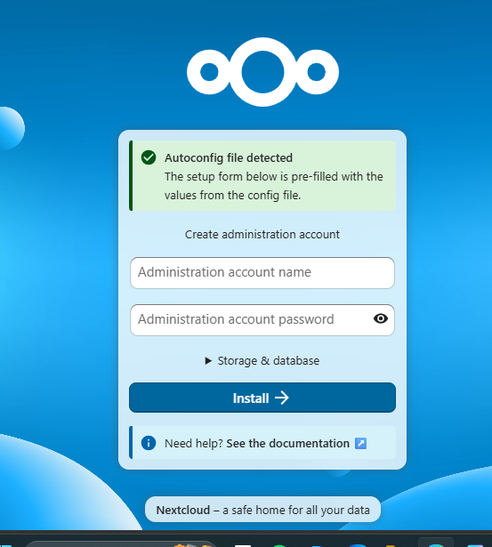
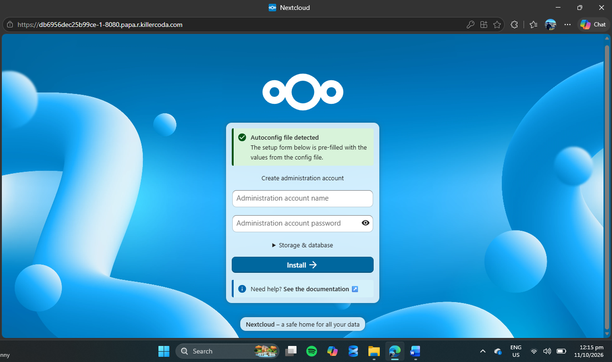
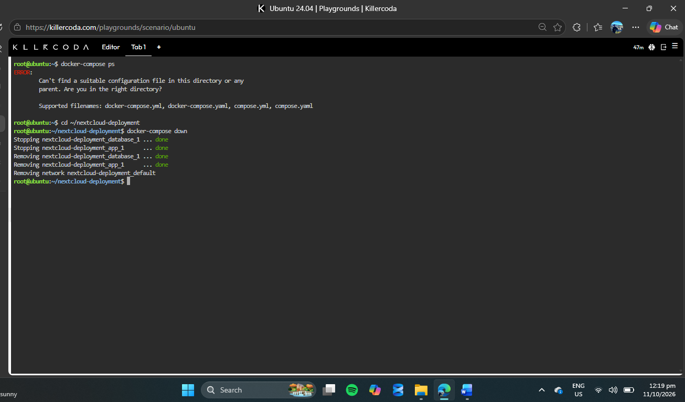

# Laboratory 06 – Cloud Deployment Engineer

**Name:** Angelo Gutoman  
**Course & Section:** BSIT 4-L

## Mission Overview

In this laboratory activity, I learned how to deploy a multi-tier application using Docker Compose. I configured Nextcloud as the web application and MariaDB as its database, allowing both containers to communicate with each other. I also learned how Infrastructure as Code makes cloud deployment easier.

## Objectives

- Understood the concept of a two-tier architecture.
- Created a `docker-compose.yml` configuration file.
- Deployed Nextcloud and MariaDB using Docker Compose.
- Accessed the Nextcloud setup page through port forwarding.
- Documented the deployment process and Infrastructure as Code principles.

## Commands Executed

I used the following commands during this laboratory activity:

    mkdir nextcloud-deployment
    cd nextcloud-deployment
    nano docker-compose.yml
    docker-compose up -d
    docker-compose ps
    docker-compose down

## Skills Learned

I learned how to write a YAML configuration file and deploy multiple containers using Docker Compose. I also learned how Nextcloud communicates with MariaDB through Docker's internal network. This activity helped me improve my Linux command-line skills and understand how multi-tier applications work.

## Challenges Encountered

One challenge I encountered was reconnecting to the KillerCoda terminal after it became disconnected. When I tried to check the containers again, I received an error because I was not inside the correct project directory. I solved this by returning to the `nextcloud-deployment` folder and continuing the required commands.

## Mission Reflection

This laboratory activity helped me understand how Docker Compose simplifies cloud deployment. I successfully deployed Nextcloud and MariaDB, verified that both containers were running, and accessed the Nextcloud installation page through port 8080. After completing the activity, I stopped and removed the containers using `docker-compose down`.

I realized that cloud deployment is not only about running commands but also about understanding how different services communicate and work together. I believe this experience improved my knowledge and confidence in using Docker Compose and managing cloud applications.

My complete reflection is documented in the `reflection.md` file.

## Screenshots

### Docker Compose Deployment

### Nextcloud Web Interface

### Docker Compose Teardown

